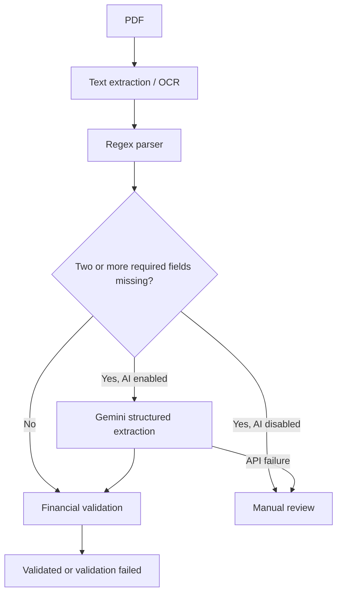

# Intelligent Document Processing

A Python portfolio project for extracting, validating and reviewing synthetic financial documents. It combines deterministic parsing, local OCR and optional generative AI to demonstrate a practical, cost-conscious automation architecture.

## Features

- PDF text extraction with PyMuPDF and Tesseract OCR fallback
- Rule-based classification, parsing and financial validation
- Batch duplicate detection using SHA-256 and financial business keys
- Batch Excel reporting
- Gemini structured extraction with Pydantic and Decimal values
- Hybrid routing: Regex first, optional AI fallback for insufficient extraction
- Local Streamlit interface for individual invoices, with JSON export
- Offline automated tests and GitHub Actions workflow

## Architecture



The original batch CLI handles classification, deduplication and Excel reports. The hybrid extractor and local UI demonstrate single-invoice extraction separately.

## Experimental results

Three synthetic invoices, seven fields each, 21 fields total. A correctly identified missing value counts as a correct field; it does not make an incomplete invoice valid.

| Method | Correct fields | Field accuracy | AI requests | AI tokens |
|---|---:|---:|---:|---:|
| Regex | 14/21 | 66.67% | 0 | 0 |
| Gemini 3.1 Flash-Lite | 21/21 | 100% | 3 | 762 |
| Hybrid | 21/21 | 100% | 1 | 255 |

Hybrid routing reduced explicit AI calls from three to one in the demonstration. Regex averaged 0.327 ms, while Gemini averaged 31.50 seconds in the original benchmark; latency varied substantially. See [benchmark results](docs/benchmark_results.md).

## Quick start (Windows PowerShell)

```powershell
py -m venv .venv
.\.venv\Scripts\python.exe -m pip install -r requirements.txt
.\.venv\Scripts\python.exe -m pytest -v
.\.venv\Scripts\python.exe -m streamlit run app.py --server.address 127.0.0.1 --browser.gatherUsageStats false
```

Install Tesseract OCR and its English language data to use the OCR feature. Set `TESSDATA_PREFIX` to the directory containing `eng.traineddata` if automatic discovery fails.

Run the existing batch demonstration:

```powershell
.\.venv\Scripts\python.exe src\generate_samples.py
.\.venv\Scripts\python.exe src\generate_duplicate_samples.py
.\.venv\Scripts\python.exe src\main.py
```

Run the hybrid demo without AI:

```powershell
.\.venv\Scripts\python.exe src\hybrid_extractor.py
```

## Optional Gemini configuration

The local demo and offline tests do not require an API key. To enable AI on built-in synthetic samples, create an ignored `.env` file at the repository root with `GEMINI_API_KEY=your_key_here`. Use a free-tier project with billing disabled. Never commit credentials. Run `git check-ignore -v -- .env` before saving a key.

```powershell
.\.venv\Scripts\python.exe src\hybrid_extractor.py --enable-ai
```

The Streamlit upload mode uses local processing only. AI is opt-in for built-in synthetic examples. Use the Gemini API only within its applicable free quota; the application does not independently verify billing settings.

## Limitations and privacy

- All demonstration data is synthetic. Do not submit confidential, personal or corporate documents to external AI services.
- The evaluation is small and does not establish production-level accuracy.
- The routing threshold is a heuristic, not a calibrated confidence score.
- Financial validation does not guarantee factual extraction accuracy or authorize payment.
- Duplicate detection is batch-scoped; cross-run persistence is not implemented.
- The UI is a local demonstration, not a production service or a replacement for the batch pipeline.
- AI failures and validation issues require human review.
